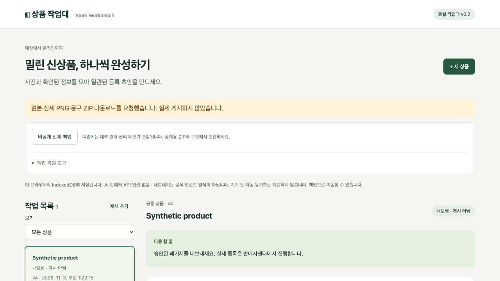

# Store Workbench · 상품 작업대

**매장에는 들어왔지만 온라인에는 못 올린 신상품을, 확인된 정보와 실사 사진으로 등록 준비하는 소상공인 작업대입니다.**

사진 촬영·정보 입력·상세페이지 제작 때문에 밀린 일을 상품별 다음 행동으로 정리합니다. 스마트스토어 수동 등록 준비부터 시작하고, 공통 상품 정보 위에 판매처별 기능 블록을 조합합니다. 사실·사진 규격·말투의 일관성을 유지하면서 상품의 고유한 형태와 옵션은 보존합니다.

**v0.2: API 키 없이 사용할 수 있는 로컬 수동 등록 준비 버전. 배포·실제 판매처 연동·실상품 현장 검증은 하지 않았습니다.**

[서비스 소개](docs/SERVICE.md) · [사용 가이드](docs/USER-GUIDE.md) · [구현 현황](docs/implementation-status.md) · [다음 작업](docs/ROADMAP.md) · [전체 PRD](docs/PRD.md) · [연동 준비](docs/CONNECTORS.md)



## 지금 사용할 수 있는 흐름

1. 상품 생성 → 원본 사진 추가·순서 조정 → 출처 기록
2. 사실별 값·출처·판매자 확인 → 옵션 SKU·가격·재고·사진 연결
3. 사진·채널 권리와 사용 기한 확인 → 확인된 사실로 로컬 템플릿 초안 작성
4. 문구·상세 배치 편집 → 실제 상세 PNG 미리보기 → 현재 내용 승인
5. 원본 이미지·상세 PNG·문구·manifest를 ZIP으로 내보내 판매자센터에서 수동 등록 준비
6. 브라우저 IndexedDB 저장 → 비공개 전체 백업 → 검증 후 새 복사본으로 복원

초안은 결정적 로컬 템플릿이며 AI가 아닙니다. 검색 문구를 정리하지만 검색량·공식 SEO 규칙·노출 향상은 검증하지 않습니다. **내보냄은 게시 완료가 아닙니다.** ZIP/JSON은 공식 일괄 업로드 양식이 아닙니다.

## 실행

Node.js 22.12 이상과 npm, 최신 Chrome을 권장합니다. 계정 연결·API 키는 필요 없습니다.

```sh
npm ci
npm run dev
```

Vite가 표시하는 `http://127.0.0.1:5173`을 엽니다. 저장 자료는 브라우저 프로필과 주소(origin)에 묶입니다. 포트·브라우저를 바꾸면 백업을 복원해 이동하세요. Web Locks가 없는 환경은 안전한 저장을 차단합니다.

```sh
npm run lint
npm run typecheck
npm test
npm run build
npm run test:ui
npm audit --audit-level=high
```

로컬 UI 검사는 설치된 Google Chrome과 비어 있는 localhost 4178을 사용합니다. CI에서는 Playwright Chromium을 설치합니다. `npm run build`는 로컬 빌드이며 배포하지 않습니다. 최신 검증: 단위 29개, 브라우저 10개, lint·typecheck·build 통과. [검증 범위와 한계](docs/implementation-status.md)를 확인하세요.

## 기능 블록과 폴더

블록은 `meta + run(input) → Result<output>` 계약으로 연결합니다. 공통 Product와 원본 ID·버전 lineage, 입력/출력 검증, 구조화 오류, 승인 종류, 비용·전송·부작용을 명시합니다. 현재 실행 블록은 로컬 처리이며 외부 전송과 유료 호출이 없습니다. 작은 모듈형 단일 앱으로 시작하며 실제 재사용처가 생기면 필요한 블록만 패키지로 추출합니다.

| 블록/경계 | 파일 | 현재 역할 |
|---|---|---|
| 공통 모델·계약 | `src/model.ts`, `src/blocks/contract.ts` | 사실/사진/SKU/초안/승인, 검증·lineage·오류 |
| 촬영·자산 | `src/blocks/capture.ts`, `assets.ts`, `src/media.ts` | 촬영 안내, 원본·출처·SHA-256·이미지 검증 |
| 후보·사실 검수 | `src/blocks/facts.ts` | 수동 후보 파서와 사람 확인을 분리 |
| 권리 | `src/blocks/rights.ts` | 사진/채널 보류, 한국 날짜 기준 기한 |
| 문구·상세 | `src/blocks/copy.ts`, `detail.ts`, `src/pipeline.ts` | 확인 사실만 생성, 편집 가능한 초안 |
| 상세 이미지 | `src/detail-renderer.ts` | 비율을 유지하는 실사와 텍스트 PNG |
| 승인·출력 | `src/blocks/approval.ts`, `channel.ts`, `package.ts` | 버전·내용 해시 승인, 공개 필드 JSON/ZIP |
| 선택형 연동 준비 | `src/blocks/providers.ts`, `smartstore-mock.ts` | 모의 계약 테스트만, 실연동 비활성 |
| 저장·복구 | `src/storage.ts`, `database.ts`, `backup.ts` | IndexedDB, 탭 잠금·스냅샷 비교, 비파괴 복원 |
| 화면 | `src/main.ts`, `style.css` | 다음 행동, 편집 보호, 사람 검수 |
| 검증 | `tests/`, `.github/workflows/ci.yml` | 단위·실제 브라우저·공개 CI |

기존 프로젝트의 구조를 참고했지만 소스를 복사하지 않고 독립적으로 작성했습니다. 시스템 폰트와 합성 테스트 자료만 포함합니다. 범용 플러그인 마켓·드래그앤드롭 워크플로·마이크로서비스는 구현하지 않았습니다.

## 데이터와 현재 한계

- PNG/JPEG/정적 WebP, 파일당 2MiB·상품당 3장. 원본 바이트를 보존합니다. EXIF 등 원본 메타데이터도 출력되므로 사진 자체를 확인하세요.
- 판매자 확인 정보만 자동 문구에 넣습니다. 수동 편집의 사실 여부와 상품/사진 권리의 적법성은 자동 판단하지 않습니다.
- 내용 변경 시 승인을 무효화합니다. 저장·다운로드 직전 공유 잠금에서 스냅샷을 확인해 다른 탭의 자료를 덮어쓰지 않습니다.
- 공개 준비 ZIP에서 내부 출처·권리 메모·검수자는 제외합니다. **비공개 백업에는 이 정보가 포함됩니다.** 구분해 보관하세요.
- 로컬 저장은 인증·암호화된 서버가 아니며 브라우저 데이터 삭제 시 유실될 수 있습니다. 백업을 따로 보관하세요.
- AI/OCR 실호출, 공식 스마트스토어/쿠팡 등록·수정·조회, 인증·협업·주문·재고 동기화는 미지원입니다. 원격 `create/update/status`는 `UNSUPPORTED`를 반환합니다.
- 실상품 5개 시험, 권리 문제 유형 확인, 판매자 필수 고시·배송·인증 매핑은 후속입니다. 로컬 승인은 공식 등록 가능 판정이 아닙니다.

초기 독립 검수 결함 [#1](https://github.com/Leebonggu/store-workbench/issues/1)·[#2](https://github.com/Leebonggu/store-workbench/issues/2)·[#3](https://github.com/Leebonggu/store-workbench/issues/3)은 회귀 테스트와 함께 수정했습니다. 현재 사용 흐름은 [#4](https://github.com/Leebonggu/store-workbench/issues/4)에서 추적합니다. CI는 검증만 실행하며 배포 단계가 없습니다.

추가 독립 검수 [#5](https://github.com/Leebonggu/store-workbench/issues/5): ZIP 블록에서 상세 PNG의 청크·CRC·압축 스트림·스캔라인 크기와 필터까지 검증합니다. 지원 출력은 비인터레이스 8비트 RGB/RGBA PNG이며, 가짜 헤더·잘림·압축 손상을 거부합니다.
