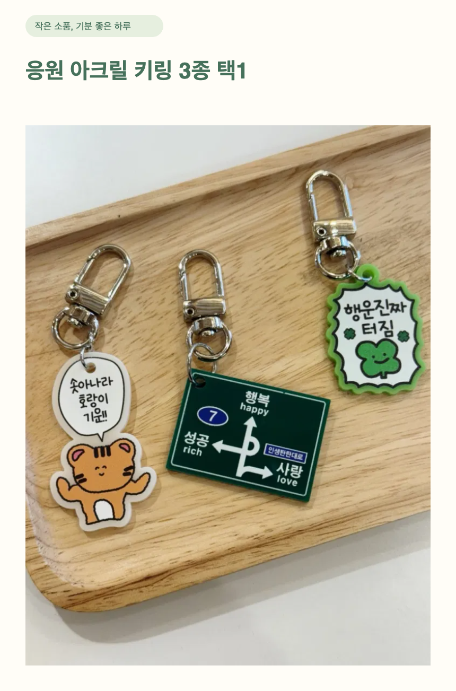

# Store Workbench · 모어비쥬 상품 작업대

**오프라인 소품샵을 혼자 운영하는 아내를 위한 상품 상세페이지 제작 에이전트입니다.** 직접 찍은 사진과 기본 상품 정보로 빠진 정보를 확인하고, 상품명·상세 설명·구매 FAQ를 제안합니다. 판매자가 검수한 뒤 상세 PNG와 문구를 내려받아 스마트스토어에 등록합니다.

노마드코더 AX School 챌린지 프로젝트입니다. [첫 과제와 클라이언트 맥락](docs/AX-SCHOOL.md) · [구현 현황](docs/implementation-status.md) · [사용 가이드](docs/USER-GUIDE.md) · [기획서](docs/PRD.md)

## 지금 되는 것 / 아직 안 되는 것

| 지금 되는 것 | 아직 안 되는 것 |
|---|---|
| 웹에서 사진·상품 정보 입력, 모어비쥬 실제 상품 3종 불러오기 | 실제 스마트스토어 자동 등록·수정·조회 |
| Flue 2.2 에이전트 + OpenRouter 연결 코드 | 대규모 품질·비용·속도 벤치마크 |
| 상품 원장 읽기 → 질문·사진 관찰 후보·설명·FAQ·검색어 제안 → 구조 검증 도구 | 검색량 조사, 검색 순위·AI 답변 인용 보장 |
| AI 제안 검토·적용·수정 요청, 기존 초안 보존 | 사진만으로 소재·크기·원산지·정품 여부 확정 |
| 깔끔하고 귀여운 상세 PNG, 원본+문구+manifest ZIP 출력 | 실상품 5개 현장 시간 절감 검증, 배포·계정·기기 간 동기화 |
| 출처·권리 확인, 버전 승인, IndexedDB 저장·비공개 백업 | 스마트스토어 공식 규칙·필수 고시 자동 판정 |

GPT-6.1 Sol로 **실제 상품 사진 3종의 Flue 호출을 검증했습니다.** [모델 비교·실호출 기록](docs/evaluations/2026-11-09-model-comparison.md)을 확인하세요. 자동 회귀 테스트는 모의 모델로 실제 Flue 런타임과 도구 호출을 검증합니다. 브라우저 AI 테스트의 문구는 고정 응답이며 실모델 생성 결과가 아닙니다. 키가 없으면 안내를 표시하고 기존 로컬 기능을 사용할 수 있습니다.

## 실행

Node.js **22.19 이상** 권장(`.nvmrc`: 22.22.0). 프로젝트에 고정한 Node 실행 파일도 npm 스크립트에서 사용합니다. 최신 Chrome을 권장합니다.

```sh
npm run setup
cp .env.example .env
# .env 파일의 OPENROUTER_API_KEY에 개인 키를 입력하세요.
npm run dev
```

웹: http://127.0.0.1:5173 · Flue 서버: http://127.0.0.1:3583

이미 `.env`가 있다면 덮어쓰지 말고 편집하세요. 기본 모델은 `openrouter/openai/gpt-6.1-sol`이며 `OPENROUTER_MODEL`로 변경합니다. 사진 입력과 도구 호출을 지원하고 Flue 모델 목록 또는 명시 등록한 모델이어야 합니다. GPT-6.1 Sol은 `agent/src/model-provider.ts`에서 OpenRouter 프로토콜로 등록합니다. 키는 서버에서만 사용하며 `VITE_` 변수에 넣지 않습니다. `.env`와 대화 DB는 Git에서 제외합니다.

OpenRouter 호출은 유료입니다. 전송 항목은 사진, 확인된 상품 정보, 판매 조건, 현재 초안, 수정 요청입니다. 내부 권리 메모·출처 증빙은 보내지 않습니다. 사진 관찰과 AI 문구는 사람이 검수해야 합니다. 전용 키의 지출 한도를 OpenRouter에서 설정하세요. 앱은 동시 요청 1개, 요청 간격 5초, 작업 90초 제한과 복구 시도 1회를 적용하지만 금액 상한을 보장하지 않습니다.

서버는 로컬 사용용입니다. 인터넷 배포 전에는 인증·사용자별 자료 분리·사용량 제한을 추가해야 합니다. Flue 대화와 전송 사진은 `agent/data/flue.db`에 남습니다. 개인 자료이므로 공유하지 마세요.

## 화면 가이드와 상품 관리

상단 **가이드 모드 ON/OFF**로 현재 상품 상태에 맞는 안내를 켤 수 있습니다. 안내는 사진·정보·권한·AI·초안·내보내기 각 위치에 표시되고 다음 영역을 강조합니다. 전환해도 미저장 입력은 유지됩니다. 자세한 [웹 가이드](http://127.0.0.1:5173/guide.html)는 상단 사용 가이드에서 새 탭으로 열립니다.

이름 없는 상품은 목록에서 선택한 뒤 제목 옆 **상품 삭제**로 지울 수 있습니다. 확인 창에서 확정해야 삭제되며, 필요하면 먼저 비공개 전체 백업을 받으세요. 기존 판매자센터 상품에는 영향을 주지 않습니다.

[가상 이미지 → 실제 GPT 생성 → 검수 → ZIP 검증 및 사용성 평가](docs/demos/2026-11-10/README.md)를 남겼습니다. 2026-11-10 브라우저 회귀 테스트 17개와 웹 빌드·타입/포맷 검사 통과. 상세한 최신 결과는 CI에서 확인할 수 있습니다.

## 사용 흐름

1. **모어비쥬 3종 불러오기** 또는 새 상품을 만들고 사진을 추가합니다.
2. 상품명·가격 등 아는 사실을 출처와 함께 확인합니다. 모르는 값은 비워둡니다.
3. **AI 제안 받기**에서 전송·비용 안내를 확인하고 요청합니다.
4. 질문과 사진 관찰 후보를 읽습니다. 새 사실은 상품 정보에 저장·확인하고 다시 요청합니다.
5. 제안을 초안에 적용합니다. “더 짧게”, “랜덤 발송 안내를 강조해줘” 등으로 수정 요청할 수 있습니다.
6. 사진 사용 권한·판매 범위를 확인한 뒤, 최신 정보로 초안을 만들고 PNG를 미리 봅니다.
7. 최종 검수·승인 후 ZIP을 내려받습니다. 판매자센터에 이미지와 본문 텍스트를 옮겨 등록합니다.

권리·상품 정보를 바꾸면 버전이 변경되므로 이전 제안은 다시 받아야 합니다. AI 요청 실패나 형식 오류는 기존 초안을 덮어쓰지 않습니다. 초안 적용은 승인을 해제합니다. 내보내기는 게시 완료가 아니며 ZIP/JSON은 공식 일괄 업로드 양식이 아닙니다.

## SEO · AEO · GEO

- 정확한 상품 유형·확인된 특징을 담은 상품명과 관련 검색어 제안. 키워드 나열·검색량 수치 창작 금지.
- 짧은 상품 요약과 “1개인가요?”, “디자인 선택 가능한가요?” 같은 구매 FAQ.
- 상품명·가격·옵션·크기·배송 조건을 일관된 텍스트로 제공. 이미지와 본문 텍스트를 함께 출력.
- 카테고리·상품 속성·필수 고시·배송·반품은 판매자센터에서 별도 확인. 웹사이트용 메타태그·구조화 데이터를 스마트스토어에 적용했다고 주장하지 않음.

[네이버 콘텐츠 작성 권장 사항](https://searchadvisor.naver.com/guide/content-basic)과 [Google AI 검색 안내](https://developers.google.com/search/docs/appearance/ai-features)를 참고했습니다. 스마트스토어 전용 랭킹 규칙으로 해석하지 않습니다.

## 출력 예시

사용자 제공 사진 + 고정 테스트 문구로 렌더링한 예시입니다. 실제 AI 생성 결과는 아닙니다.



[상품 정보·FAQ 이미지 보기](docs/images/morebijou-info-v03.png)

## 구조와 검증

```text
기존 Vite 웹 → /api 프록시 → Flue + Hono 서버 → OpenRouter
                               ├─ inspect_product: 확인 사실·누락 읽기
                               └─ submit_proposal: 형식 검증·판매 조건 보존
웹 검수 → 상세 PNG 렌더링 → 승인 버전 ZIP
```

- `src/`: 웹, 상품 원장, 승인·출력·저장
- `agent/src/`: Flue 에이전트, 서버 경계, SQLite 대화 저장
- `shared/`: 공개 AI 요청·응답 계약
- `fixtures/morebijou.json`: 사용자가 제공한 테스트 상품 정보. 페이지 직접 검증 미완료
- `tests/`, `agent/tests/`: 단위·브라우저·실제 Flue 도구 호출 테스트

```sh
npm run lint
npm run typecheck
npm test
npm run check:agent
npm run test:agent
npm run build
npm run build:agent
npm run test:ui
npm audit --audit-level=high
npm --prefix agent audit --audit-level=high
```

Flue 2.3과 자동 선택된 Pi 1.5 조합에서 `Type` export 오류가 확인되어 Flue 2.2 / Pi 0.87.1로 고정했습니다. 보안 수정된 Valibot·MCP 의존성도 overrides로 고정하며 lockfile을 커밋합니다.

2026-11-09 로컬 검증: 단위 31개, Flue 런타임 2개, 브라우저 12개 통과. 웹/서버 타입검사·빌드와 양쪽 의존성 audit 통과(취약점 0건). GPT 실모델 사진 포함 3종 호출도 통과했습니다. 판매자 사용성·시간 절감 검증은 별도입니다.
