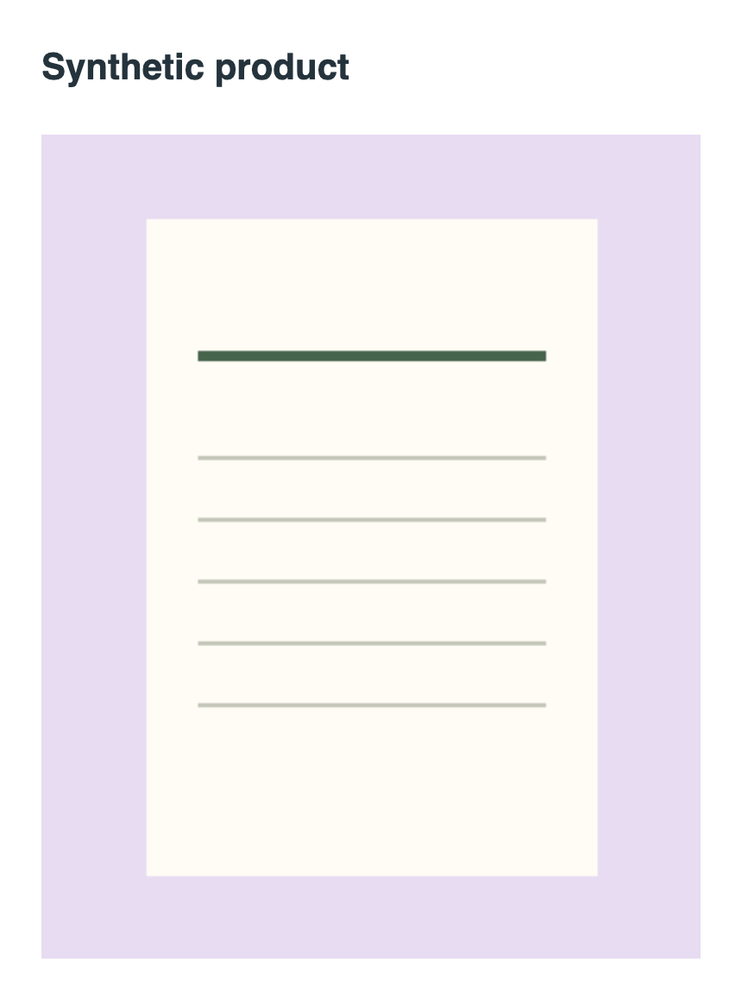

# v0.3 AI 사용 추가 안내

실행은 저장소 루트에서 `npm run setup` 후 `.env`를 설정하고 `npm run dev`입니다. 웹은 5173, Flue 서버는 3583입니다. 키가 없어도 로컬 작업은 가능합니다.

1. “모어비쥬 3종 불러오기”로 테스트하거나 새 상품에 사진을 올립니다.
2. 상품명·가격 등 확인한 정보를 저장합니다.
3. “AI와 상세페이지 만들기”에서 요청을 적고 전송·비용 안내에 체크합니다.
4. 질문에 대한 새로운 상품 사실은 공통 상품 정보에 입력·확인합니다. 질문 답변을 수정 요청에만 적으면 확정 사실로 취급하지 않습니다.
5. 제안을 적용하고 문구·사진을 검수합니다. 수정 요청은 현재 초안을 함께 전송합니다.
6. 권리를 확인·저장한 뒤 최신 버전으로 제안을 다시 받거나 로컬 초안을 생성합니다. 미리보기·승인·ZIP 출력 순으로 마칩니다.

제안은 자동으로 기존 초안을 바꾸지 않습니다. 적용 버튼은 기존 편집 초안을 교체하고 승인을 해제합니다. 상품 버전이 바뀌면 오래된 제안 적용을 거부합니다. AI 질문/관찰은 비공개 백업에 저장되며 복원 시 제안은 제외하고 적용된 초안만 복원합니다.

키 설정 오류는 `.env`와 잔액을 확인하고 서버를 다시 시작하세요. 자동 재전송하지 않으므로 중복 비용을 피하려면 이전 요청 상태를 확인하세요.

아래는 기존 로컬 작업 안내입니다. AI 미지원으로 적힌 문구는 v0.2 시점 기록이며 현재 범위는 [README](../README.md)를 따릅니다.

---

# 사용 가이드 · v0.2

이 앱은 상품 등록 준비 자료를 만드는 로컬 작업대입니다. 실제 게시와 판매자센터 필수값 확인은 판매자가 진행합니다.

## 1. 시작과 저장 위치

README의 실행 명령으로 앱을 열고 `예시 추가`로 흐름을 살펴보거나 `새 상품`을 선택합니다. 예시는 실상품이 아닌 합성 데이터이며 자동 승인되지 않습니다. 작업 목록에서 상품을 선택하면 다음 할 일이 표시됩니다.

자료는 현재 주소와 브라우저 프로필의 IndexedDB에 저장됩니다. 인터넷 계정이나 서버 동기화가 없습니다. 기존 v0.1 localStorage 자료는 검증 후 읽으며, 다음 저장부터 IndexedDB로 옮깁니다. 이전 원본은 자동 삭제하지 않습니다.

각 입력 영역은 저장 또는 `입력 취소` 후 다음 영역으로 이동하세요. 저장 완료 안내를 확인해야 다음 작업이 가능합니다. 미저장 상태에서는 다른 영역의 변경을 막아 입력 유실을 줄입니다.

## 2. 사진과 상품 사실

촬영 안내에 따라 실제 상품 전체와 특징·크기가 드러나는 사진을 준비합니다. 파일과 출처를 입력해 원본을 추가하세요. PNG/JPEG/정적 WebP만 지원하며 1장 2MiB 이하, 상품당 3장입니다. `앞으로`로 사진 순서를 바꾸고 필요 없는 연결을 제거할 수 있습니다. 옵션이 사용하는 사진은 옵션 연결부터 바꿔야 제거할 수 있습니다.

상품명·가격·소재·크기·원산지를 실제 자료와 대조해 값과 출처를 입력하고 확인 체크 후 저장합니다. 가격은 양의 정수 원화로 입력합니다. 모르는 항목을 추측하지 마세요. 후보 텍스트 가져오기는 단순 로컬 파서이며 후보를 자동 확정하지 않습니다.

옵션이 있으면 SKU별 이름·판매가·선택적 재고·사진을 입력합니다. SKU 이름은 중복될 수 없고 최대 50개입니다. 빈 새 행은 무시합니다. 기존 행의 이름·가격·재고·사진 선택을 모두 비우면 저장 시 해당 행이 제거됩니다. 재고는 로컬 준비값이며 판매처와 동기화되지 않습니다.

## 3. 권리 확인

사진별 사용 권한과 해당 채널에서의 판매·자료 사용 범위를 확인합니다. 권한이 불명확하면 보류하세요. 공급사 사진 허락, 상품 관련 권리, 채널 제한은 서로 다를 수 있으며 앱이 법적 사용 허가를 판단하지 않습니다.

내부 메모에 확인 근거를 기록하고 기간 제한이 있으면 만료일을 입력합니다. 만료일 당일까지 한국 날짜(UTC+9)로 유효하며 다음 날부터 승인·출력을 막습니다. 이 필드는 로컬 확인 기록이며 권리 증빙 파일 보관 기능은 없습니다.

## 4. 문구와 상세 PNG 검수

`저장된 정보로 초안 만들기`를 누릅니다. 확인된 사실로 결정적 템플릿 문구를 만들며 AI/OCR을 호출하지 않습니다. 상품명과 설명을 직접 수정할 수 있습니다. 사진 먼저/정보 먼저, 초록/짙은 회색 배치를 선택하고 저장하세요. 재생성은 기존 편집을 바꾸므로 교체 확인이 필요합니다.

`상세 PNG 미리보기`에서 실제 출력 이미지를 확인합니다. 사진은 자르거나 상품 형태를 생성하지 않고 원본 비율에 맞춰 배치합니다. 출력 폭은 860px이고 긴 정보는 여러 장으로 나뉩니다. 제목·글 잘림, 사진과 옵션의 일치 여부를 검수하세요. 시스템 폰트 때문에 운영체제에 따라 줄바꿈이 조금 달라질 수 있습니다.

## 5. 승인과 공개 준비 ZIP

검수자를 입력하고 사진·문구 확인 체크 후 `현재 버전 승인`을 누릅니다. 권리 보류나 필수 사실 누락이 있으면 사유를 표시합니다. 상품·문구·레이아웃을 바꾸면 이전 승인은 해제되므로 다시 검수하세요.

ZIP 내보내기를 선택하고 브라우저의 다운로드 완료를 확인하세요.

| 파일 | 용도 |
|---|---|
| `originals/` | 원본 이미지 바이트 그대로, 안전한 새 파일명 |
| `detail/` | 미리보기와 같은 배치의 실제 상세 PNG |
| `listing.txt` | 제목·설명과 수동 등록 확인 목록 |
| `manifest.json` | 가격·SKU·사진 연결·버전·해시 등 공개 준비 필드 |
| `READ-ME.txt` | 패키지 사용 범위와 주의점 |

내부 출처·권리 메모·검수자는 공개 준비 출력에서 제외됩니다. 사진 자체에 포함된 글자·EXIF는 제거하지 않습니다. JSON 단독 내보내기도 가능하지만 ZIP이 사진 파일을 직접 쓰기 편합니다. 둘 다 공식 업로드 양식이나 프로젝트 백업이 아닙니다.

판매자센터에서 카테고리·필수 고시·배송·반품·인증 해당 여부·옵션·최종 가격을 확인하고 직접 등록하세요. 화면의 `내보냄 · 게시 아님`은 다운로드 요청 기록입니다. 실제 게시나 업로드 성공을 확인한 상태가 아닙니다.

## 6. 비공개 백업과 복원

`비공개 전체 백업`으로 작업 원본을 별도 보관하세요. **백업에는 내부 출처·권리 메모·검수자 등 비공개 정보가 포함됩니다. 판매처에 업로드하지 마세요.** 자동 암호화하지 않으므로 접근 가능한 사람을 제한해 보관합니다.

`백업 복원 도구`를 펼치고 프로젝트 백업 JSON을 선택해 확인 체크 후 복원합니다. 가져오는 파일은 100MiB 이하·상품 100개 이하만 지원합니다. 모든 상품을 검증한 후 기존 상품을 보존하면서 새 복사본을 추가합니다. 복원된 사본은 승인·내보냄 상태를 지우므로 다시 검수해야 합니다. 공개 준비 JSON/ZIP은 복원용 백업이 아닙니다.

## 오류 해결

| 안내/증상 | 조치와 보존 동작 |
|---|---|
| 다른 탭에서 변경 | 현재 입력을 따로 복사한 뒤 새로고침. 오래된 저장·다운로드는 차단하며 다른 탭 자료를 덮어쓰지 않음 |
| 저장 공간 부족/차단 | 기존 저장 자료와 현재 입력 유지. 브라우저 저장 권한·공간을 확인하고 사진 용량을 줄임 |
| 사진 형식·무결성 오류 | 파일을 사진 도구에서 정상 PNG/JPEG로 내보낸 뒤 다시 선택. 확장자 변경만으로 해결하지 않음 |
| 손상 저장 자료 | 유효한 상품은 읽기 전용 표시. 원본 복구 자료 다운로드 후 유효한 비공개 백업 복원 가능. 복원 전 손상 원문도 별도 IDB 항목에 보존 |
| 백업 복원 실패 | 기존 상품을 변경하지 않음. 파일 종류·용량·버전을 확인. 복원 실패 원본을 공개 이슈에 그대로 올리지 않음 |
| 승인/내보내기 불가 | 다음 행동·보류 사유 확인. 사실/사진/권리/만료일/초안 버전을 수정한 뒤 재검수 |
| 다른 주소에서 빈 목록 | 동일 브라우저 프로필·포트로 접속하거나 별도 보관한 백업 복원 |

브라우저 자료 전체를 삭제하면 로컬 원본·복구 항목도 사라집니다. 이 앱에만 중요한 자료를 보관하지 마세요. 현재 상품 삭제·서버 계정·기기 간 자동 동기화·영구 변경 이력은 지원하지 않습니다.
